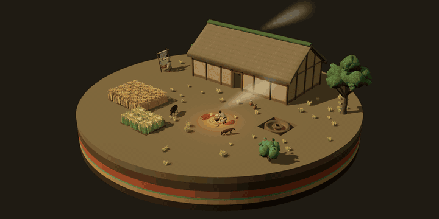

  <picture>
    <source media="(prefers-color-scheme: dark)" srcset="docs/brand/readme/banner-dark.svg">
    
  </picture>

**Strata Bohemica** is a digital open-air museum of Bohemian prehistory. It is a Godot 4.5 simulation in which you watch a village and its inhabitants through the seasons, without steering them. Reconstructions are labelled with how well their sources support them.

  

Render of the project's own models, 14 s loop. All reconstructions are provisional.

## Status

Early development. The source code and the 3D models will be published in this repository. Until a licence is added, all rights are reserved, including to the brand assets in [`docs/brand/`](docs/brand/BRAND.md).

## Brand

The mark is three contour lines around a patina-green pit, an excavation plan. Colours, type and usage rules are in [`docs/brand/BRAND.md`](docs/brand/BRAND.md).
