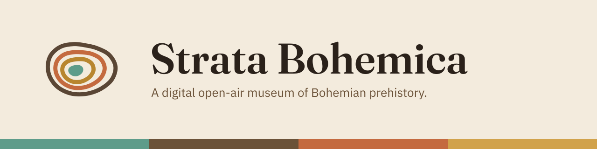
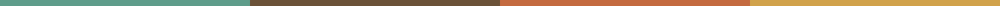

  <picture>
    <source media="(prefers-color-scheme: dark)" srcset="docs/brand/readme/banner-dark.svg">
    
  </picture>

**Strata Bohemica** is a digital open-air museum of Bohemian prehistory. It is a Godot 4.5 simulation in which you watch a village and its inhabitants through the seasons, without steering them. Reconstructions are labelled with how well their sources support them.

  

Render of the project's own models, 14 s loop. All reconstructions are provisional.

<a href="https://strata-bohemica.github.io/strata-bohemica/museum/"><b>Enter the museum</b></a> (a village with ten working homesteads, in your browser) · <a href="https://strata-bohemica.github.io/strata-bohemica/">the living diorama</a>

## Status

Early development. The living diorama above runs in the browser; the museum itself (a Godot 4.5 project in [`museum/`](museum/)) is being built homestead by homestead.

## Licence

- **Models, textures, animations and renders:** [CC BY 4.0](LICENSE-ASSETS.md). Use them, also commercially, with credit.
- **Source code:** [MIT](LICENSE).
- **Name, wordmark and logo** ([`docs/brand/`](docs/brand/BRAND.md)): all rights reserved.
- Third-party material: [THIRD_PARTY.md](THIRD_PARTY.md).

All reconstructions are provisional.

## Brand

The mark is three contour lines around a patina-green pit, an excavation plan. Colours, type and usage rules are in [`docs/brand/BRAND.md`](docs/brand/BRAND.md).
